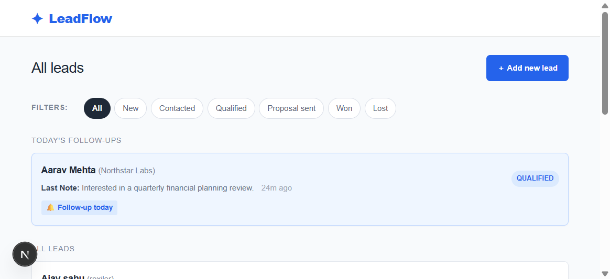
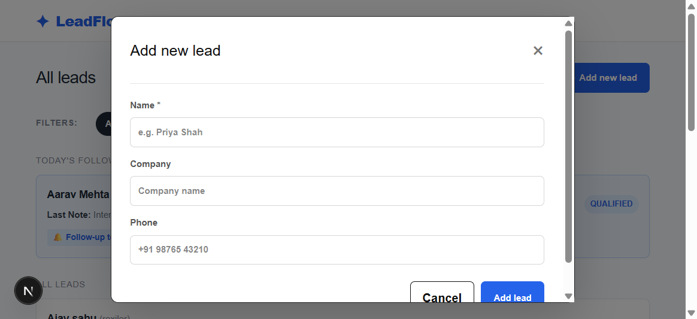
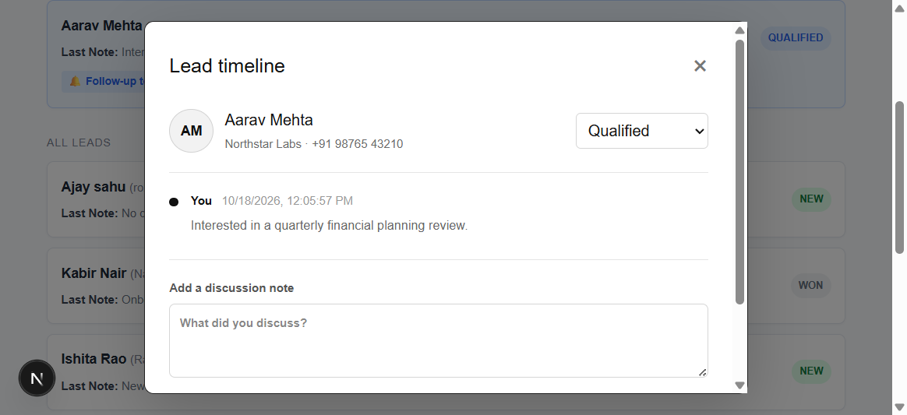

# LeadFlow

LeadFlow is a focused lead management dashboard for sales teams. It helps users browse and filter leads, track follow-ups, review discussion history, update lead status, and create new leads from a single responsive interface.

## Features

- View all leads with their latest discussion note and current status.
- Filter leads by status and search by name or company.
- Highlight leads with follow-ups due today.
- Add leads with optional company and phone details.
- Open a lead timeline, update its status, and add discussion notes.
- Schedule or update follow-up dates and times.
- Delete leads with cascading discussion cleanup.
- Validate API request bodies with Zod.

## Tech Stack

- Frontend: React 19, Next.js 16, CSS
- Backend: Next.js App Router route handlers
- Database: SQLite with Prisma ORM 7
- Validation: Zod
- Database driver: `better-sqlite3` with Prisma's SQLite adapter
- Tools: npm, Git, ESLint

## Project Structure

```text
pravar/
├── app/
│   ├── api/leads/              # Lead and discussion API routes
│   ├── globals.css             # Global styles
│   ├── layout.js               # Root layout
│   └── page.js                 # LeadFlow dashboard
├── lib/
│   ├── lead-validation.js      # Zod schemas and API error helpers
│   └── prisma.js               # Shared Prisma client
├── prisma/
│   ├── migrations/             # Database migrations
│   ├── schema.prisma           # Database schema
│   └── seed.js                 # Example lead data
├── public/                     # Static assets
├── .env.example
├── prisma.config.ts            # Prisma CLI configuration
└── README.md
```

## Prerequisites

- Node.js 20.9 or newer
- npm

SQLite is included through the project dependencies, so a separate database server is not required for local development.

## Installation

1. Clone the repository:

	```bash
	git clone https://github.com/divyanshu978/LeadFlow.git
	```

2. Navigate to the project:

	```bash
	cd LeadFlow
	```

3. Install dependencies:

	```bash
	npm install
	```

4. Create your local environment file:

	**Windows PowerShell**

	```powershell
	Copy-Item .env.example .env
	```

	**macOS/Linux**

	```bash
	cp .env.example .env
	```

5. Apply the database migrations and seed example data:

	```bash
	npm run db:migrate
	npm run db:seed
	```

## Environment Variables

Create a `.env` file in the project root:

```env
DATABASE_URL="file:./dev.db"
```

The URL is used by `prisma.config.ts` for Prisma CLI commands and by the SQLite adapter when the application runs.

## Running the Project

Start the development server:

```bash
npm run dev
```

Open [http://localhost:3000](http://localhost:3000) in your browser.

Useful commands:

```bash
npm run build        # Create a production build
npm run start        # Start the production server
npm run lint         # Run ESLint
npm run db:generate  # Generate the Prisma client
npm run db:migrate   # Apply or create a development migration
npm run db:seed      # Reset and seed example data
```

## API Endpoints

| Method | Endpoint | Description |
| --- | --- | --- |
| GET | `/api/leads` | List leads, optionally filtered by `status` and `search` |
| POST | `/api/leads` | Create a lead |
| GET | `/api/leads/:id` | Get a lead and its discussion timeline |
| PATCH | `/api/leads/:id` | Update lead details or status |
| DELETE | `/api/leads/:id` | Delete a lead |
| GET | `/api/leads/:id/discussions` | List discussions for a lead |
| POST | `/api/leads/:id/discussions` | Add a discussion note and optionally update follow-up time |

Request validation errors return `422`, missing leads return `404`, successful creation returns `201`, and unexpected server errors return `500`.

## Screenshots

### Lead dashboard



### Add a new lead



### Lead timeline



## Future Improvements

- Add authentication and role-based access control.
- Add pagination and richer lead search.
- Add reminders or notifications for overdue follow-ups.
- Add reporting for conversion rates and pipeline activity.
- Add automated API and end-to-end tests.

## Contributing

1. Fork the repository.
2. Create a feature branch.
3. Make your changes and run `npm run lint` and `npm run build`.
4. Commit your changes.
5. Open a pull request.

## License

No license has been selected for this project yet.

## Contact

- GitHub: [divyanshu978](https://github.com/divyanshu978)
